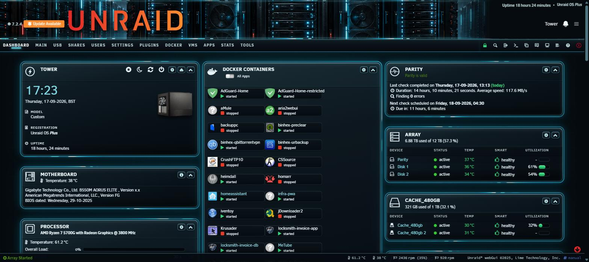
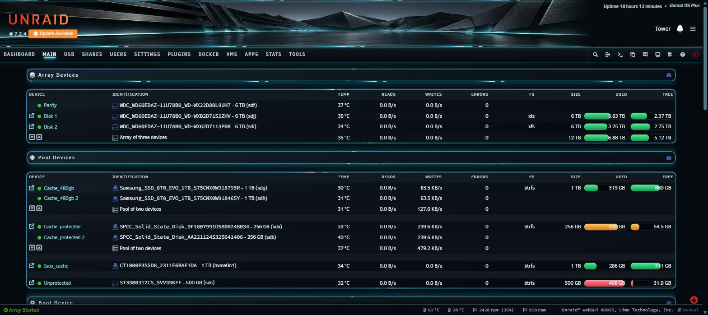

# ARCLIGHT — Unraid webGUI theme

A dark-room datacentre look: near-black ground, steel-blue panels, cyan LED accents and warm
ember highlights. **Rounded corners**, unlike TITANIUM's chamfered ones.



## Where the palette comes from

Every colour was sampled from the banner artwork that ships with this theme, not picked by eye:

| Role | Value | Sampled from |
|---|---|---|
| Ground | `#050a0e` | the near-black the racks sit in |
| Panels | `#0b181f` → `#151b20` → `#252a2f` | rack faces, front to back |
| Accent | `#3fc3e0` | the cyan LED strips (`#0684a6` core) |
| Bloom | `#8fd8e5` | LED highlight |
| Warning | `#f7702d` | wordmark gradient, warm end |
| Critical | `#e83c29` | wordmark hot end / red rack LEDs |

The banner's warm accents happen to land exactly where Unraid's **warning** and **critical**
colours live, so the ember reads as part of the system rather than decoration — and the usage
thresholds keep their meaning. Threshold green stays `#35d77d` on purpose.

## Rounded, not chamfered

TITANIUM cuts its corners with `clip-path` octagons and traces the cut edges with four 1px
drop-shadows (a border would follow the rectangle and leave the cut edges bare). ARCLIGHT
rounds instead:

- every chamfer is switched off for a `border-radius` (14px panels and titles, 12px cards)
- with a radius, a real 1px ring works, so the drop-shadow outline trick is dropped
- the perimeter energy rings were hollow octagons built with `clip-path: polygon(evenodd, …)`.
  They are re-cut as **masked rings** (`mask-composite: exclude`) so they follow the curve.

Everything else TITANIUM does structurally is intact: smoked-glass card interiors, the orbiting
pulse ring, outer bloom, contained wide tables, and the mobile pass.



## Install

*Plugins → Install Plugin*:

```
https://raw.githubusercontent.com/GaBoNtZ/unraid-themes/main/arclight/arclight-theme.plg
```

Then select the **Black** theme in *Settings → Display Settings* and hard-refresh (Ctrl+F5).

Only one theme plugin at a time — they all write `themes/black.css`. Removing restores the
stock stylesheet, which ships inside the plugin.

## Banner

**This theme is designed around its banner** — the palette was sampled from it, so they belong
together. Both files are **2560 × 172** (14.88:1), which fills the Unraid header edge to edge
with no cropping: a 1905px-wide window gives a header of exactly 1905 × 128, the same ratio.

| File | Notes |
|---|---|
| `banner.png` | rack artwork with the ember UNRAID wordmark — **the intended one** |
| `banner-plain.png` | same artwork without the wordmark |

Because the artwork carries its own wordmark, the theme **hides Unraid's native logotype** —
otherwise you get two UNRAID wordmarks side by side. The version number and the *Update
Available* badge are kept and sit beside the lettering.

> If you use `banner-plain.png` instead, re-enable the native logotype or you will have no
> wordmark at all:
> ```css
> #header unraid-header-os-version a img { display: revert !important; }
> ```

The banner is a separate Unraid setting, so the theme never overwrites yours. To use it:

```
cp banner.png /boot/config/plugins/dynamix/banner.png
```

then set *Settings → Display Settings → Banner* to **image**.

## Compatibility

Built and verified on **Unraid 7.2.4** (`min="7.0.0"`): 155 rules, zero parse errors, page
overflow 0 on Dashboard and Main, wide tables scrolling inside their own containers. Lime Tech
moves selectors between releases, so re-check after a major OS upgrade.

## Regenerating

`make-arclight.py` derives the whole stylesheet from TITANIUM: it deepens the ground, retunes
the blue band onto the sampled LED hues, pins the identity tokens, and appends the rounded-corner
override block. Change the palette in one place and rebuild.
