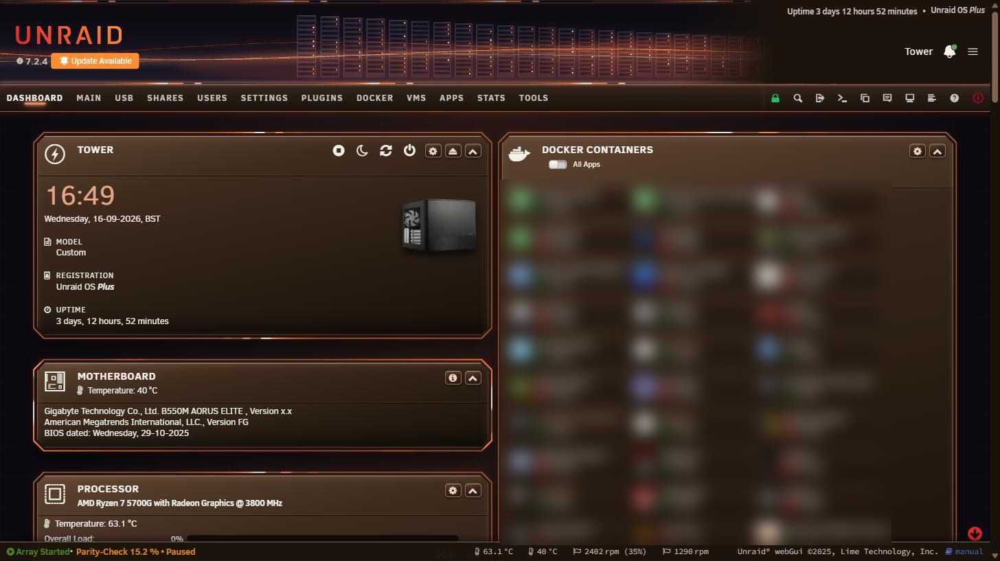

# EMBER — Unraid webGUI theme

TITANIUM's structure in a warm orange palette, taken from [getwayland.com](https://getwayland.com).



## What it looks like
Warm near-black panels (`#1a1828` over `#0c0a11`) with the signature orange `#ff6b35` as the accent,
peach `#ffcaa8` highlights and `#f4f1e8` warm off-white text. Everything TITANIUM does structurally
is here: chamfered panels on every page, deeper smoked-glass interiors, full perimeter energy rings,
and an outer bloom hugging each panel's cut corners.

The palette came from hue-rotating TITANIUM's entire cyan family into the orange band, so every rail,
ring, border and glow keeps its original brightness relationship instead of being recoloured by hand;
the identity colours were then pinned to Wayland's exact values.

Usage bars keep Unraid's green / amber / red threshold meaning — the amber warning tone was shifted
yellow-ward so it stays distinguishable from the orange accent.

## Install

**Plugins tab (recommended)** — *Plugins → Install Plugin*, paste:
```
https://raw.githubusercontent.com/GaBoNtZ/unraid-themes/main/ember/ember-theme.plg
```
**By hand** — copy `ember-theme.plg` to `/boot/config/plugins/` then:
```
installplg /boot/config/plugins/ember-theme.plg
```
Then pick the **Black** theme in *Settings → Display Settings* and hard-refresh (Ctrl+F5).

## Uninstall
*Plugins → Remove* — the stock Black theme is restored from the copy shipped inside the plugin.

## Gotchas
- **Only install one theme from this repo at a time.** They all write to `themes/black.css`.
- Hard-refresh after installing; browsers and phones cache the stylesheet hard.
- Rings and bloom are animated; they honour `prefers-reduced-motion` (and iOS Low Power Mode).
- Built against **Unraid 7.2.4** (`min="7.0.0"`); re-check after a major OS upgrade.

## Files
| File | Purpose |
|---|---|
| `ember-theme.plg` | The plugin, stylesheet embedded inline. |
| `source/black.css` | The stylesheet on its own. |
| `screenshot.jpg` | The theme running on a live 7.2.4 server. |
| `banner.png` | Matching orange server-rack banner (optional, see below). |

CSS only — no scripts, no PHP, no page templates, no containers, no services.

## Matching banner (optional)

The artwork is **not** part of the theme — Unraid keeps it separate. The banner used in the
screenshot ships alongside as `banner.png`:

```
scp banner.png root@tower:/boot/config/plugins/dynamix/banner.png
```
Then *Settings → Display Settings* → set **Banner** to the custom image. The plugin never touches
your banner, so installing or removing a theme leaves your own artwork alone.

---

Free, and always will be. If it made your server nicer to look at, [buy me a coffee](https://buymeacoffee.com/gabontz) ☕
